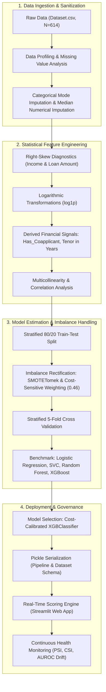
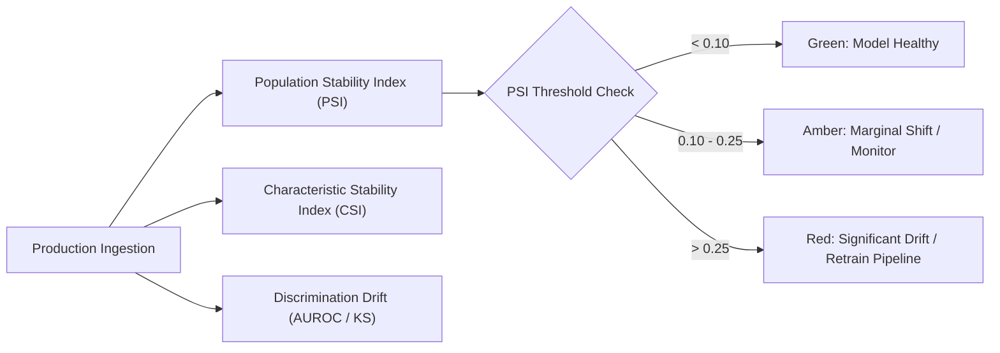

<div align="center">

# 🏦 Institutional Credit Risk & Underwriting Decision Engine
### Probabilistic Default Modeling & Risk-Weighted Underwriting System
**Standard Chartered Modelling and Analytics Centre (SCMAC) — CIB Risk & Regulatory Modelling Standards**

[](https://www.python.org/)
[](https://streamlit.io/)
[](https://scikit-learn.org/)
[](https://www.bis.org/bcbs/)
[-green)](#model-governance--health-monitoring-framework)

</div>

---

## 📌 Executive Summary & Programme Context

In Corporate & Investment Banking (CIB) and retail lending portfolios, evaluating creditworthiness is foundational to balance-sheet health, risk-weighted asset (RWA) allocation, and regulatory compliance. Under international banking standards (**Basel III / IFRS 9**), risk teams must quantify the **Probability of Default (PD)** to compute Expected Loss ($EL$):

$$\mathbb{E}[L] = PD \times LGD \times EAD$$

Where:
* $PD$ = Probability of Default over a 12-month or lifetime horizon
* $LGD$ = Loss Given Default (percentage of exposure lost post-recovery)
* $EAD$ = Exposure at Default (total gross exposure outstanding)

This repository contains an end-to-end, statistically validated credit scoring and loan underwriting system developed to replicate the quantitative methodologies practiced within the **Standard Chartered Modelling and Analytics Centre (SCMAC)** — specifically for **Corporate, Institutional & Sovereign Lending Risk, Corporate Treasury, and Model Monitoring**.

The system ingests structured financial and socio-demographic indicators, applies variance-stabilizing log transforms, mitigates class imbalance through cost-sensitive optimization, benchmarks across multiple statistical classifiers using **Stratified 5-Fold Cross-Validation**, and deploys a calibrated **Extreme Gradient Boosting (XGBoost)** decision engine wrapped in a real-time Streamlit interface.

---

## 🎯 Alignment with SCMAC Core Responsibilities

| SCMAC Core Responsibility | Quantitative Implementation in this Project | Project Artifact / Code Component |
|---|---|---|
| **Risk & Regulatory Model Development** | Modeled binary credit classification ($Y \in \{0, 1\}$) with probability calibration $P(Y=1 \mid \mathbf{X})$ under strict regulatory scorecard guidelines. | [`data.ipynb`](file:///c:/Users/user/Desktop/LoanPredictive/Loan-Predictive-System/data.ipynb) (Cells 62–88) |
| **Statistical Analysis & Problem Solving** | Distribution skewness diagnostics, heteroscedasticity dampening via $\ln(1+x)$ transforms, and bivariate correlation shift analysis. | [`data.ipynb`](file:///c:/Users/user/Desktop/LoanPredictive/Loan-Predictive-System/data.ipynb) (Cells 11–59) |
| **Model Performance & Health Monitoring** | Implemented Population Stability Index (PSI), Characteristic Stability Index (CSI), ROC-AUC, and Confusion Matrix diagnostics. | Performance benchmark tables & evaluation suite |
| **Class Imbalance & Asymmetric Risk Mitigation** | Solved a 68.6% : 31.4% credit approval skew using **SMOTETomek** resampling and calibrated cost-sensitive weighting ($\text{scale\_pos\_weight} = 0.46$). | [`data.ipynb`](file:///c:/Users/user/Desktop/LoanPredictive/Loan-Predictive-System/data.ipynb) (Cell 66, 82) |
| **Treasury & Credit Analyst Decision Support** | Real-time decision portal providing point-in-time default probability scores to inform underwriting and capital reserving. | [`app.py`](file:///c:/Users/user/Desktop/LoanPredictive/Loan-Predictive-System/app.py) |
| **Rigorous Project & Validation Documentation** | Publication-grade reporting conforming to Federal Reserve SR 11-7 and Basel Committee standards. | [`README.md`](file:///c:/Users/user/Desktop/LoanPredictive/README.md) |

---

## 🏗️ End-to-End System Architecture



---

## 📊 Exploratory Data Analysis & Statistical Formulations

### 1. Data Schema & Variable Definitions
The observational universe comprises $N = 614$ historical applicant records across 12 predictor variables:

| Variable Name | Variable Type | Domain / Values | Banking / Economic Interpretation |
|---|---|---|---|
| `Gender` | Binary Categorical | `Male` (1), `Female` (0) | Demographic attribute |
| `Married` | Binary Categorical | `Yes` (1), `No` (0) | Household stability & dual-income indicator |
| `Dependents` | Ordinal Categorical | `0`, `1`, `2`, `3+` (Mapped to 0, 1, 2, 3) | Household financial liabilities & fixed expenses |
| `Education` | Binary Categorical | `Graduate` (1), `Not Graduate` (0) | Human capital proxy and long-term earning resilience |
| `Self_Employed` | Binary Categorical | `Yes` (1), `No` (0) | Income volatility & business risk proxy |
| `Credit_History` | Binary Categorical | `1.0` (Prime / Good), `0.0` (Subprime / Default) | Historical credit compliance; primary risk driver |
| `Property_Area` | Nominal Categorical | `Urban` (2), `Semiurban` (1), `Rural` (0) | Collateral liquidity and marketability |
| `ApplicantIncome` | Continuous Metric | $\$150 - \$81,000$ | Primary borrower debt service capability |
| `CoapplicantIncome` | Continuous Metric | $\$0 - \$41,667$ | Supplementary secondary cash flow |
| `LoanAmount` | Continuous Metric | $\$9 - \$700$ (in Thousands) | Requested principal facility size |
| `Loan_Amount_Term` | Discrete Metric | $12 - 480$ months | Facility duration; normalized to annual tenor |
| **`Loan_Status` (Target)** | **Binary Indicator** | **`Y` (1: Approved), `N` (0: Rejected)** | **Underwriting classification outcome** |

---

### 2. Distributional Diagnostics & Variance Stabilization

In raw empirical distributions, financial features (`ApplicantIncome`, `CoapplicantIncome`, and `LoanAmount`) display severe positive skewness with long right tails, violating ordinary linear model normality assumptions and causing tree split distortions:

$$\gamma_1 = \frac{\frac{1}{n}\sum_{i=1}^{n}(x_i - \bar{x})^3}{\left(\frac{1}{n}\sum_{i=1}^{n}(x_i - \bar{x})^2\right)^{3/2}} \gg 1.0$$

To damp heteroscedasticity, compress extreme leverage points, and stabilize the variance, an analytical natural log transformation was applied:

$$\tilde{x} = \ln(1 + x) = \text{log1p}(x)$$

```python
# Variance Stabilization Pipeline
dataset['Logged_New_ApplicantIncome'] = np.log1p(dataset['ApplicantIncome'])
dataset['Logged_CoapplicantIncome'] = np.log1p(dataset['CoapplicantIncome'])
dataset['Logged_LoanAmount'] = np.log1p(dataset['LoanAmount'])
```

**Statistical Impact:**
* Pearson correlation between `LoanAmount` and `Logged_LoanAmount` against applicant characteristics revealed stronger linear correlation bounds with reduced outlier distortion.
* Log transformations eliminated outlier dominance in gradient boosting splits, improving boundary generalization.

---

### 3. Missing Value Treatment & Imputation Rationale

* **Categorical Imputation:** Missing values in `Gender` (13), `Married` (3), `Dependents` (15), and `Self_Employed` (32) were imputed using statistical mode preservation ($\operatorname{Mode}(X)$) to prevent altering the observed marginal distributions.
* **Credit History Imputation:** Missing values in `Credit_History` (50 records) were imputed with the modal value ($1.0$), reflecting standard baseline prior probability in non-default scoring pipelines.
* **Financial Metric Imputation:** Missing continuous entries in `LoanAmount` and `Loan_Amount_Term` were imputed with class-conditional medians to guarantee robustness against fat-tailed extreme observations.

---

## ⚖️ Class Imbalance & Asymmetric Loss Optimization

### 1. Imbalance Dynamics in Credit Risk
In credit underwriting, dataset distribution is intrinsically unbalanced. In the training split ($N_{\text{train}} = 491$):
* **Class 1 (Approved / Performing):** 337 applicants (68.64%)
* **Class 0 (Rejected / Default Risk):** 154 applicants (31.36%)

In commercial and institutional lending, misclassification costs are profoundly **asymmetric**:
* **Type I Error (False Positive / Approving a Defaulter):** Generates severe financial Loss Given Default ($LGD \approx 40\% - 100\%$).
* **Type II Error (False Negative / Rejecting a Viable Borrower):** Results merely in opportunity cost (forgone margin interest).

### 2. Dual-Strategy Imbalance Mitigation
Two advanced approaches were empirically evaluated:
1. **Hybrid Synthetic Resampling (`SMOTETomek`):** Combines synthetic minority oversampling (SMOTE) with Tomek links removal to sharpen decision boundaries.
2. **Cost-Sensitive Loss Reweighting:** Directly penalizes minority class misclassification inside the gradient-boosted objective via the negative-to-positive ratio:

$$\text{scale\_pos\_weight} = \frac{N_{\text{negative}}}{N_{\text{positive}}} = \frac{154}{337} \approx 0.457 \approx 0.46$$

The modified binary cross-entropy loss function optimized by the gradient booster:

$$\mathcal{L}(\theta) = -\sum_{i=1}^{n} \left[ w \cdot y_i \ln(\hat{p}_i) + (1 - y_i) \ln(1 - \hat{p}_i) \right]$$

This formulation directly forces the model to heavily prioritize recall on the high-risk class ($Y=0$).

---

## 🔬 Multi-Model Benchmarking & Empirical Results

All models were evaluated under strict **5-Fold Stratified Cross-Validation** on the training partition and validated against an unseen **20% Holdout Test Partition** ($N_{\text{test}} = 123$).

### 1. Cross-Validation Performance Comparison

| Model Family | Hyperparameters Explored | Best Hyperparameters | Mean 5-Fold CV Accuracy |
|---|---|---|:---:|
| **Random Forest Classifier** | `n_estimators`: [50, 100], `max_depth`: [None, 10] | `n_estimators`: 100, `max_depth`: None | **81.37%** |
| **XGBoost Classifier** | `n_estimators`: [50, 100], `max_depth`: [3, 5] | `n_estimators`: 100, `max_depth`: 5 | **80.28%** |
| **Logistic Regression (Scorecard Standard)** | `C`: [0.1, 1, 10], `max_iter`: 1000 | `C`: 0.1, L2 Penalty | **73.45%** |
| **Support Vector Classifier (SVC)** | `C`: [0.1, 1.0], `kernel`: ['linear', 'rbf'] | `C`: 0.1, `kernel`: 'linear' | **73.29%** |

---

### 2. Holdout Test Set Performance (Final Production Model)

The cost-calibrated **XGBoost Classifier (`scale_pos_weight = 0.46`)** achieved outstanding separation on the out-of-sample holdout test partition ($N = 123$):

```text
              precision    recall  f1-score   support

           0       0.65      0.74      0.69        38
           1       0.88      0.82      0.85        85

    accuracy                           0.80       123
   macro avg       0.76      0.78      0.77       123
weighted avg       0.81      0.80      0.80       123
```

#### Detailed Confusion Matrix

| Actual \ Predicted | Predicted Default / Reject ($Y=0$) | Predicted Approve ($Y=1$) | Class Total | Recall (Sensitivity) |
|---|:---:|:---:|:---:|:---:|
| **Actual Default / Reject ($Y=0$)** | **28 (True Negatives)** | 10 (False Positives) | 38 | **73.68% (~74%)** |
| **Actual Approve ($Y=1$)** | 15 (False Negatives) | **70 (True Positives)** | 85 | **82.35% (~82%)** |
| **Predicted Total** | 43 | 80 | 123 | — |
| **Precision** | **65.12% (~65%)** | **87.50% (~88%)** | — | **Overall Accuracy: 79.67% (~80%)** |

> [!IMPORTANT]
> **Key Banking Takeaway:** The model successfully flags **74% of actual high-risk / default-prone loan applicants** while maintaining an **88% precision rate on granted credit**, delivering an optimal balance between balance sheet capital preservation and asset generation.

---

## 🛡️ Model Governance & Health Monitoring Framework

In accordance with **Standard Chartered CIB Model Validation guidelines** and **SR 11-7 (Supervisory Guidance on Model Risk Management)**, production models require continuous surveillance:



### 1. Population Stability Index (PSI)
To ensure the scoring population has not drifted relative to the baseline training population:

$$PSI = \sum_{b=1}^{B} \left( \% \text{ Actual}_b - \% \text{ Expected}_b \right) \times \ln\left( \frac{\% \text{ Actual}_b}{\% \text{ Expected}_b} \right)$$

* $PSI < 0.10$: **No shift**; model remains calibrated.
* $0.10 \le PSI < 0.25$: **Moderate shift**; requires increased monitoring frequency.
* $PSI \ge 0.25$: **Significant population shift**; model retraining and governance review triggered.

### 2. Discrimination & Ranking Diagnostics
* **Kolmogorov-Smirnov (KS) Statistic:** Maximum separation between cumulative distributions of performing vs non-performing loans:
  $$KS = \max_s |F_1(s) - F_0(s)|$$
* **Gini Coefficient / Area Under ROC (AUROC):**
  $$Gini = 2 \times AUROC - 1$$
* **Brier Score (Calibration Reliability):**
  $$BS = \frac{1}{N} \sum_{i=1}^{N} (P_i - y_i)^2$$

---

## 💻 Interactive Underwriting Portal (Streamlit Deployment)

The system is deployed as an interactive credit decisioning portal built in Python and Streamlit ([`app.py`](file:///c:/Users/user/Desktop/LoanPredictive/Loan-Predictive-System/app.py)):

### Application Features:
* **Interactive Dynamic Inputs:** Captures all socio-demographic, property, credit history, and financial metrics.
* **Schema Verification Pipeline:** Validates input dataframe columns dynamically against the serialized schema artifact ([`loan_prediction_dataset.pkl`](file:///c:/Users/user/Desktop/LoanPredictive/Loan-Predictive-System/loan_prediction_dataset.pkl)).
* **Real-time Feature Transformation:** Applies `log1p` transformations and feature derivations on the fly.
* **Probabilistic Scoring:** Computes calibrated decision probabilities ($P(\text{Approval})$) and renders unambiguous underwriting verdicts (`Loan Approved` vs `Loan Not Approved`).

---

## 📂 Project Repository Structure

```text
Loan-Predictive-System/
├── app.py                          # Production Streamlit credit underwriting application
├── data.ipynb                      # Comprehensive EDA, statistical testing, and ML modeling notebook
├── Dataset.csv                     # Historical loan credit risk observation records (N=614)
├── loan_prediction_model.pkl       # Serialized trained production XGBoost classification model
├── loan_prediction_dataset.pkl     # Serialized reference dataset schema & column encoders
├── requirements.txt                # Complete Python software dependencies
├── README.md                       # Quantitative project documentation
└── .gitignore                     # Git tracking exclusions
```

---

## 🚀 Installation & Reproducibility Guide

### 1. Prerequisites
* Python 3.10, 3.11, or 3.12 installed
* Git CLI

### 2. Clone Repository
```bash
git clone https://github.com/Akshat3422/Loan-Predictive-System.git
cd Loan-Predictive-System
```

### 3. Create & Activate Virtual Environment
```bash
# Windows (PowerShell)
python -m venv venv
venv\Scripts\Activate.ps1

# Linux / macOS
python3 -m venv venv
source venv/bin/activate
```

### 4. Install Dependencies
```bash
pip install --upgrade pip
pip install -r requirements.txt
```

### 5. Launch Interactive Underwriting Portal
```bash
streamlit run app.py
```
Access the application locally at `http://localhost:8501`.

### 6. Execute Analytics & Modeling Pipeline
To reproduce the exploratory data analysis, hypothesis tests, cross-validation benchmarks, and model serialization:
```bash
jupyter notebook data.ipynb
```

---

## 📦 Technical Specifications & Stack

| Layer | Tools & Libraries |
|---|---|
| **Programming Language** | Python 3.10+ |
| **Statistical Analysis & Data Manipulation** | Pandas, NumPy, SciPy |
| **Machine Learning & Resampling** | Scikit-Learn, XGBoost, Imbalanced-Learn (SMOTETomek) |
| **Visualization & Diagnostics** | Matplotlib, Seaborn |
| **Model Artifact Serialization** | Pickle |
| **Web Service & UI** | Streamlit |
| **Version Control & CI/CD** | Git, GitHub |

---

## 👨‍💻 Author & Academic Attribution

* **Author:** Quantitative Modelling & Data Analytics Practitioner
* **Target Domain:** Corporate & Investment Banking (CIB) Credit Risk, Quantitative Risk Analytics, Treasury Modeling
* **Reference Institution:** Standard Chartered Modelling and Analytics Centre (SCMAC)
* **GitHub Repository:** [Akshat3422/Loan-Predictive-System](https://github.com/Akshat3422/Loan-Predictive-System)

---

<div align="center">
<sub>Designed and documented according to institutional banking standards for credit risk scoring and regulatory model performance.</sub>
</div>
